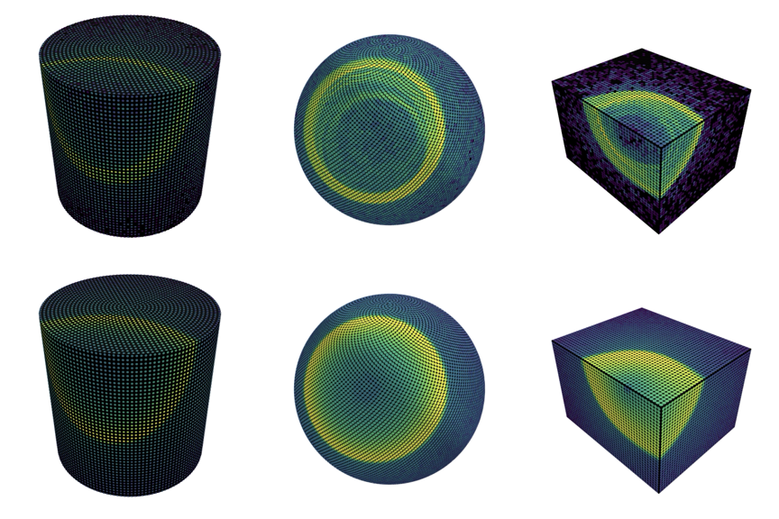

# LUCiD

LUCiD (Light-based Unified Calibration and trackIng Differentiable simulation) simulates optical
photon transport in particle detectors and is written in [JAX](https://github.com/google/jax).
For a particle track or a calibration source it computes the expected charge and hit times on
every sensor, together with their derivatives with respect to the track and to the detector's
optical parameters. Calibration and track reconstruction then become gradient-based fits to the
observed data. It is written for people working on water Cherenkov detectors, water-based liquid
scintillator (WbLS) and neutrino telescopes in ice.

Light emission from muons and electrons comes from a small neural network (SIREN) trained on
Geant4 photon tables from PhotonSim, so running LUCiD does not need Geant4. Units are metres,
nanoseconds and MeV.



## Getting started

Simulation, calibration and reconstruction need only JAX and a few Python packages. LUCiD is
installed from a clone; Python 3.10 with jax 0.5.3 is the tested version.

```bash
git clone https://github.com/CIDeR-ML/LUCiD.git && cd LUCiD
python3.10 -m venv .venv && . .venv/bin/activate
pip install -e . -c tests/constraints.txt
python scripts/download_data.py      # SIREN weights and example events, 142 MB
python examples/hello_simulate.py    # one 1 GeV muon, writes hello_simulate.png
```

[Installation](docs/getting-started/install.md) covers GPU builds and the optional extras, and
the [quickstart](docs/getting-started/quickstart.md) goes through this example and its gradient.
[`examples/`](examples/README.md) has scripts for calibration, reconstruction, a neutrino
telescope and multi-particle events. New Geant4 datasets are produced with PhotonSim, locally,
in the `ghcr.io/cider-ml/lucid` container or on a cluster
([producing datasets](docs/guides/production/index.md)).

## Documentation

https://cider-ml.github.io/LUCiD/, built from [`docs/`](docs/index.md). The paper's figures are
reproduced from [`analysis/paper/`](analysis/paper/README.md).

## Citation

If you use LUCiD, please cite:

> O. Alterkait, C. Jesús-Valls, R. Matsumoto, P. de Perio, K. Terao,
> *End-to-end Differentiable Calibration and Reconstruction for Optical Particle Detectors*,
> arXiv:2602.24129 (2026).

[`CITATION.cff`](CITATION.cff) has the same reference in machine-readable form.

## Licence

No open licence has been granted yet: the code is all rights reserved, and [`LICENSE`](LICENSE)
states the current terms. An open licence is being pursued through SLAC's Office of Technology
Licensing. The data release assets (`scripts/download_data.py`) are under CC BY 4.0.
Third-party material keeps its own terms ([`THIRD_PARTY.md`](THIRD_PARTY.md)).
